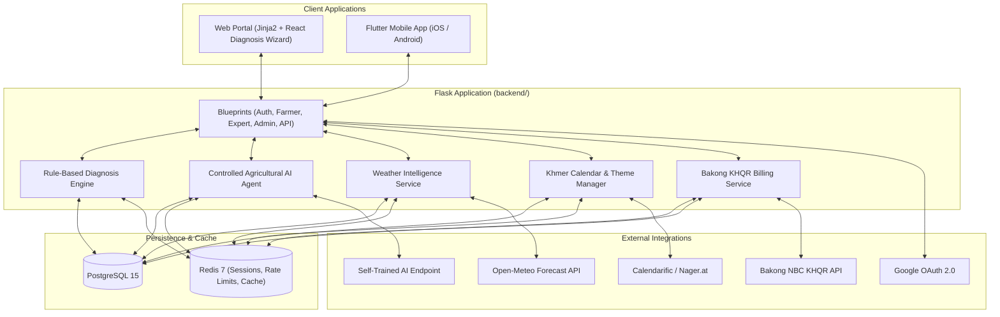

# Integrated Agricultural Expert System

[](https://www.python.org/)
[](https://flask.palletsprojects.com/)
[](https://react.dev/)
[](https://flutter.dev/)
[](https://www.postgresql.org/)
[](https://docs.docker.com/compose/)

An accessible, multi-role agricultural advisory platform designed to help farmers, agronomists, and administrators diagnose crop diseases, monitor weather-driven field risks, and manage domain knowledge across **web** and **mobile** interfaces with full **English and Khmer** localization.

---

## Table of Contents

- [Architecture Overview](#-architecture-overview)
- [Core Capabilities](#-core-capabilities)
- [Technology Stack](#️-technology-stack)
- [Repository Structure](#-repository-structure)
- [Getting Started](#-getting-started)
- [Testing & Security Audits](#-testing--security-audits)
- [AI Training & Dataset Export](#-ai-training--dataset-export)
- [Documentation](#-documentation)

---

## 🏗️ Architecture Overview

The platform is organized as a modular monorepo combining a **Flask** backend (REST APIs + Jinja2 SSR portals), a **React + Vite** Diagnosis Wizard bundle, a cross-platform **Flutter** mobile client, and isolated **AI/ML** training and inference pipelines.



---

## ✨ Core Capabilities

### 1. Rule-Based Crop Disease Diagnosis
- **Adaptive Clarification Wizard:** A React-powered step-by-step wizard tailored for low-technical-literacy farmers, narrowing candidate diseases with 5–7 adaptive yes/no questions.
- **Weighted Diagnostic Scoring:** Ranks candidate diseases across *Fungal*, *Bacterial*, *Viral*, *Pest*, *Nutrient*, and *Environmental* categories using:

  $$\text{Score} = (0.60 \times \text{Symptom Coverage}) + (0.20 \times \text{Precision}) + (0.20 \times \text{Expert Confidence}) - (0.45 \times \text{Contradiction Penalty})$$

- **Structured Outcomes & Feedback:** Delivers actionable immediate mitigation, long-term prevention steps, and captures farmer helpfulness feedback for expert review.
- **Seeded Crops:** Pre-populated knowledge base covers **Rice**, **Potato**, **Tomato**, **Cucumber**, **Chili Pepper**, **Banana**, **Corn**, and **Cassava**.

### 2. Bilingual AI Agricultural Assistant (`AGY V2.0.0`)
- **Controlled Agent Layer:** Routes farmer queries through trusted application tools (seeded agricultural knowledge base and live weather context) before invoking the remote fine-tuned model (`AI_PROVIDER=own-ai`).
- **Process Isolation:** Flask communicates strictly via `HF_INFERENCE_URL` and `HF_TOKEN` without loading model weights inside web workers.
- **Resilient Bilingual Support:** Full English and Khmer language handling with automatic Khmer text normalization.

### 3. Weather Intelligence
- **Localized Forecasts:** Fetches coordinate-based agricultural weather via **Open-Meteo** (no API key required).
- **Automated Field Alerts:** Evaluates storm risk (wind $> 45\text{ km/h}$), heavy rain/waterlogging ($> 35\text{ mm}$), heat stress ($> 38^\circ\text{C}$), and pesticide spray-drift safety windows ($< 25\text{ km/h}$).
- **Multi-Tier Caching:** Uses Redis or in-memory TTL caching (10-minute fresh window) with stale-forecast fallback during upstream outages.

### 4. Khmer Calendar & Seasonal Theme Manager
- **Lunar Alignment:** Converts Gregorian dates to Khmer lunar calendar data (zodiac year, lunar month, moon phase) via `khmerdate`.
- **Automated Seasonal Styling:** Synchronizes UI themes with Cambodian agricultural seasons and national holidays via Calendarific / Nager.at (with offline defaults).

### 5. Security, RBAC & Bakong KHQR Billing
- **Three-Tier RBAC:** Dedicated portals and permissions for `farmer`, `expert`, and `admin` roles.
- **Modern Authentication:** Server-backed Redis sessions, Google OAuth 2.0, WebAuthn **Passkeys**, two-factor verification, device login-activity tracking, and strict rate limiting.
- **Local Payments:** Native **Bakong KHQR** checkout generation and transaction verification for Pro subscriptions.

---

## 🛠️ Technology Stack

| Domain | Technologies |
| :--- | :--- |
| **Backend** | Python 3.11+ • Flask 3.1 • Gunicorn • SQLAlchemy 2.0 • Alembic / Flask-Migrate |
| **Database & Cache** | PostgreSQL 15 • Redis 7 (Flask-Session & Flask-Limiter) |
| **Web Frontend** | React 18 • Vite 7 • Tailwind CSS 3 • PostCSS • Jinja2 |
| **Mobile Client** | Flutter (Dart SDK ^3.12) • Provider • HTTP Cookie Session Management |
| **AI / ML** | Fine-tuned LoRA weights • Hugging Face Space / Standalone FastAPI Inference |
| **Auth & Payments** | Authlib (Google OAuth) • WebAuthn (Passkeys) • Bakong KHQR SDK |
| **Infrastructure** | Docker • Multi-stage Dockerfile • Docker Compose • GitHub Actions CI |

---

## 📁 Repository Structure

See [docs/architecture.md](docs/architecture.md) for the full directory reference and module breakdown.

```text
Project_Assignment/
├── backend/              # Flask application, Alembic migrations, seeds, and Python tests
│   ├── app/              # Blueprints, models, domain services, templates, and static assets
│   ├── migrations/       # Alembic schema revisions
│   ├── seeds/            # Role, permission, user, and rule-based knowledge seeders
│   └── tests/            # Python unittest suite (160 unit & integration tests)
├── frontend/             # React + Vite Diagnosis Wizard & Node.js regression tests
├── mobile/               # Flutter cross-platform application (Android, iOS, macOS, Windows)
├── ai/                   # Datasets, LoRA training scripts, HF Space app, and inference server
├── docs/                 # Architecture guide, security specs, and OpenAPI/Postman specs
├── scripts/              # Operational CLI utilities, dataset exporters, and CVE auditor
├── archived/             # Archived historical scratch files and one-off dev utilities
├── Dockerfile            # Multi-stage production container build (Node 22 + Python 3.11)
└── docker-compose.yml    # Full-stack orchestration (Flask + PostgreSQL 15 + Redis 7)
```

---

## 🚀 Getting Started

### Option A: Docker Compose (Recommended)

Docker Compose builds the React frontend, starts PostgreSQL 15 and Redis 7, applies database migrations, seeds initial data, and launches Gunicorn.

1. Create your environment file:
   ```bash
   cp .env.example .env
   ```
   Configure `SECRET_KEY`, `POSTGRES_*`, `HF_INFERENCE_URL`, `HF_TOKEN`, and any optional OAuth/Bakong keys in `.env`.

2. Build and start the stack:
   ```bash
   docker compose up --build
   ```

3. Access the application at **`http://localhost:5000`**.

---

### Option B: Local Development

#### 1. Backend Setup (Python 3.11+)
```bash
python3 -m venv .venv
source .venv/bin/activate        # Windows: .venv\Scripts\activate
pip install -r backend/requirements.lock

cp .env.example .env
```

#### 2. Frontend Build (Node.js 22+)
```bash
cd frontend
npm ci
npm run build
cd ..
```
*Vite automatically outputs the compiled Diagnosis Wizard bundle to `backend/app/static/diagnosis-wizard/`.*

#### 3. Database Initialization & Seeding
```bash
export FLASK_APP=backend/run.py

python backend/setup_db.py
flask --app backend/run.py db stamp head

python backend/seeds/seed_roles.py
python backend/seeds/seed_permissions.py
python backend/seeds/seed_admin.py
python backend/seeds/seed_expert.py
python backend/seeds/seed_farmer.py
python backend/seeds/seed_rule_based_knowledge.py
```

#### 4. Start the Flask Server
```bash
python backend/run.py
```
Open **`http://localhost:5000`** in your browser.

#### 5. Mobile App (Optional, Flutter)
```bash
cd mobile
flutter pub get
flutter run
```

---

## 🧪 Testing & Security Audits

Continuous integration runs automated security audits, lockfile parity validation, builds, and regression tests via [`.github/workflows/dependency-audit.yml`](.github/workflows/dependency-audit.yml).

```bash
# 1. Backend unit & integration tests (160 tests)
.venv/bin/python -m unittest discover -s backend/tests -v

# 2. Frontend regression tests (20 tests)
node --test frontend/tests/*.cjs frontend/tests/*.mjs

# 3. Mobile unit tests
cd mobile && flutter test

# 4. Dependency parity, tree integrity, and CVE audit (Python + npm)
.venv/bin/python scripts/audit_dependencies.py --check-lockfile --strict

# 5. Python lint check
.venv/bin/ruff check backend/ scripts/
```

---

## 🤖 AI Training & Dataset Export

Agricultural knowledge tables can be exported cleanly for supervised fine-tuning (excluding PII, user records, chat logs, and secrets):

```bash
python scripts/export_to_jsonl.py --out-dir ai/datasets/exports
```

This generates:
- `ai/datasets/exports/agri_train_data.jsonl`
- `ai/datasets/exports/agri_validation_data.jsonl`
- Dataset manifest metadata

Refer to [`ai/deployment/README.md`](ai/deployment/README.md) for deploying the standalone inference server.

---

## 📚 Documentation

| Document | Description |
| :--- | :--- |
| [Monorepo Architecture](docs/architecture.md) | Complete directory layout and developer workflows |
| [OpenAPI Auth Specification](docs/api/openapi_auth_spec.json) | REST API authentication contract & schemas |
| [Postman Collection](docs/api/postman_auth_collection.json) | Ready-to-import API test collection |
| [Rule Engine Design](docs/rule_based_diagnosis_engine_design.md) | Diagnosis scoring and adaptive questioning model |
| [Weather Intelligence](docs/weather_intelligence_module.md) | Forecast caching, thresholds, and fallback architecture |
| [Session Security](docs/session_security.md) | Server-side Redis sessions, timeouts, and CSRF controls |
| [Dependency Management](docs/dependency_management.md) | Lockfile pinning and CVE auditing policies |
| [Railway Migration Guide](docs/railway_migration.md) | Cloud deployment steps for Railway |
| [Code Review Agent](.github/agents/code-reviewer.agent.md) | Repository code review guidelines |
