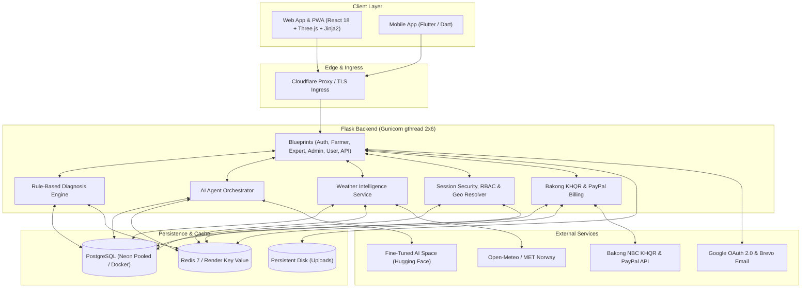

<div align="center">

# AgriSystem

**Bilingual AI Agricultural Expert & Crop Disease Diagnosis Platform**

Full-stack monorepo combining a **Flask** backend, **React + TypeScript** web workspace (with interactive Three.js 3D showcase and PWA mobile support), **Flutter** cross-platform client, and isolated **LoRA AI inference**. Built for farmers, agronomists, and administrators with complete **English** and **Khmer (ភាសាខ្មែរ)** support.

[Live Production](https://www.agricultureexp.com) · [Architecture](docs/architecture.md) · [Quick Start](#getting-started) · [Deployment](#deployment) · [Documentation](#documentation)

[](https://www.python.org/)
[](https://flask.palletsprojects.com/)
[](https://react.dev/)
[](https://www.typescriptlang.org/)
[](https://www.postgresql.org/)
[](https://redis.io/)
[](https://flutter.dev/)
[](https://docs.docker.com/compose/)

</div>

---

## Overview

AgriSystem bridges expert agronomy rules, generative agricultural AI, localized weather forecasting, and direct specialist consultations inside a single multi-role platform:

- **Farmers** — Guided 4-step symptom diagnosis, bilingual AI crop assistant (text, image, and Khmer/English TTS audio), weather risk alerts, agricultural dispatches, live chat with experts/admins (voice, image, and GPS sharing), and Bakong KHQR / PayPal Pro subscriptions.
- **Agronomy Experts** — Review and verify farmer diagnoses, refine disease rules and symptom weights, reply to farmer consultations, and curate agricultural knowledge.
- **Administrators** — Role and permission governance (RBAC), user and subscription administration, translation center, live support routing, seasonal theme automation, and security audit telemetry.

---

## Key Capabilities

### 1. Rule-Based Crop Disease Diagnosis Engine
- **4-Step Adaptive Wizard:** Built in React + Vite (`frontend/src/diagnosis/`) for low-friction mobile use, narrowing candidates across crops, symptom groups, and optional leaf images with live match previews.
- **Weighted Diagnostic Scoring:** Ranks differential matches across *Fungal*, *Bacterial*, *Viral*, *Pest*, *Nutrient*, and *Environmental* categories:

  $$\text{Score} = (0.60 \times \text{Symptom Coverage}) + (0.20 \times \text{Precision}) + (0.20 \times \text{Expert Confidence}) - (0.45 \times \text{Contradiction Penalty})$$

- **Seeded Agronomy Knowledge Base:** Ships with structured symptoms, causes, treatment protocols, and prevention steps for **Rice**, **Potato**, **Tomato**, **Cucumber**, **Chili Pepper**, **Banana**, **Corn**, and **Cassava**.

### 2. Bilingual AI Copilot & Speech Narration
- **Isolated Model Boundary:** Web workers never load model weights directly; `Flask` communicates with the fine-tuned inference service strictly over HTTPS (`AI_PROVIDER=own-ai`, `HF_INFERENCE_URL`, `HF_TOKEN`).
- **Context-Aware Tooling:** Grounds responses with database crop/disease knowledge and localized weather data before generating answers in English or Khmer.
- **Bilingual Audio Playback:** Server-side `/farmer/api/tts` supports personal Gemini TTS keys (`gemini-3.8-flash-tts`) and automated English/Khmer speech synthesis with HTTP `206` byte-range streaming for Safari and mobile browsers.

### 3. Weather Intelligence & Field Advisory
- **Dual-Provider Resilience:** Queries **Open-Meteo** with **MET Norway** fallback and interactive map embeds.
- **Actionable Risk Evaluation:** Computes automated thresholds for storm wind (`> 45 km/h`), heavy rainfall/waterlogging (`> 35 mm`), heat stress (`> 38 °C`), and spray-drift safety windows (`< 25 km/h`).
- **Multi-Tier Caching:** Stores 10-minute fresh forecasts and 6-hour stale fallbacks in Redis or thread-safe worker memory.

### 4. Account Security, Device Sessions & Media UX
- **Hardened Authentication:** Server-backed Redis sessions (`Flask-Session`), Google OAuth 2.0, WebAuthn biometric **Passkeys**, email OTP 2FA, PBKDF2/scrypt password hashing, and shared Redis rate-limit budgets (`Flask-Limiter`).
- **Real Device & Location Tracking:** Parses hardware models (`Sec-CH-UA-Model` Client Hints + User-Agent classification) and resolves cached city/country geolocation instead of exposing raw IP addresses in user session security views.
- **Client-Side Avatar Cropper:** Built-in interactive HTML5 `<canvas>` cropper modal supporting touch/mouse pan, zoom, `90°` rotation, and `512×512` JPEG export before profile upload.

---

## System Architecture



---

## Technology Stack

| Layer | Technologies |
| :--- | :--- |
| **Backend Web & API** | Python 3.11+ · Flask 3.1 · Gunicorn 23 (`gthread`) · SQLAlchemy 2.0 · Alembic / Flask-Migrate |
| **Database & Caching** | PostgreSQL 15 / Neon Serverless PostgreSQL (`psycopg2`) · Redis 7 (Sessions, Rate Limits, Weather & IP Geo Cache) |
| **Web Frontend** | React 18 · TypeScript 7 · Vite 7 · Tailwind CSS 3 · Three.js (custom WebGL canvas) · Lucide Icons |
| **Mobile Client** | Flutter (Dart SDK `^3.12`) · Provider · Cookie Session & Local Persistence |
| **AI & Data Tooling** | Self-trained LoRA weights · `gradio-client` / FastAPI Inference · JSONL Dataset Exporter |
| **Auth & Integrations** | Authlib (Google OAuth 2.0) · `webauthn` (Passkeys) · `bakong-khqr` · PayPal · Open-Meteo · `khmerdate` · Brevo |
| **Quality & CI** | Python `unittest` · Node `node --test` · `tsc --noEmit` · `pip-audit` / `npm audit` · Lockfile Auditor · GitHub Actions |

---

## Project Structure

```text
Project_Assignment/
├── backend/                     # Flask application, Gunicorn config, migrations, seeds, and tests
│   ├── app/
│   │   ├── blueprints/          # Role & feature routes (admin, api, assistant, auth, expert, farmer, main, staff, user, weather)
│   │   ├── models/              # SQLAlchemy ORM models
│   │   ├── services/            # Rule engine, AI integration, weather, themes, IP geolocation, login activity, Bakong
│   │   ├── templates/           # Jinja2 shells mounting compiled React bundles
│   │   ├── utils/               # Security headers, rate limiting, CSRF/validation, audit logging, i18n, session security
│   │   ├── __init__.py          # Application factory (create_app)
│   │   └── config.py            # Environment configuration & Neon/Redis builders
│   ├── migrations/              # Alembic database schema revisions
│   ├── seeds/                   # Roles, permissions, sample accounts, and crop disease knowledge seeders
│   ├── tests/                   # Python unittest suite (224 tests)
│   ├── entrypoint.sh            # Container startup (wait-for-DB, migrations, seeds, upload seeding, Gunicorn)
│   └── gunicorn.conf.py         # Gunicorn gthread worker tuning & server header masking
├── frontend/                    # React + TypeScript + Vite monorepo UI
│   ├── src/
│   │   ├── components/          # Shared shell, navigation, 3D showcase, avatar cropper, weather & drawers
│   │   ├── diagnosis/           # Standalone 4-step Guided Diagnosis Wizard
│   │   ├── pages/               # Farmer, Expert, Admin, Auth, Error, and User Account portals
│   │   └── styles/              # Tailwind CSS + mobile safe-area / PWA stylesheets
│   └── tests/                   # Node.js regression & contract test suite (54 tests)
├── mobile/                      # Flutter client (Android, iOS, macOS, Windows, Linux)
├── ai/                          # Curated datasets, LoRA fine-tuning scripts, HF Space app, inference server
├── docs/                        # Architecture, security policies, API specs, and cloud migration guides
├── scripts/                     # Dependency auditor, JSONL dataset exporter, DB/SMTP operational utilities
├── .github/workflows/           # CI workflow (pip check, lockfile parity, npm audit, build, unit tests)
├── Dockerfile                   # Multi-stage build (Node 22 Vite builder -> Python 3.11 runtime)
├── docker-compose.yml           # Local full stack (PostgreSQL 15 + Redis 7 + Flask + optional Cloudflared)
└── render.yaml                  # Render Infrastructure-as-Code Blueprint (Web + Key Value + 10 GB Disk)
```

---

## Getting Started

### Prerequisites

- **Docker option:** Docker Engine & Docker Compose
- **Manual local option:** Python `3.11+`, Node.js `22+`, PostgreSQL `15+`, and optional Redis `7`

### Option 1: Docker Compose (Recommended)

1. Copy the example environment configuration and fill in `SECRET_KEY`, `POSTGRES_*`, and integration tokens:

   ```bash
   cp .env.example .env
   ```

2. Build and start PostgreSQL, Redis, and the Flask + Vite stack:

   ```bash
   docker compose up --build
   ```

   `entrypoint.sh` automatically waits for PostgreSQL, initializes/migrates the schema, runs baseline role/permission/knowledge seeds, and serves the app at `http://localhost:5000`.

### Option 2: Local Development Setup

<details>
<summary>Expand step-by-step backend, frontend, database, and mobile setup</summary>

#### 1. Python Backend

```bash
python3 -m venv .venv
source .venv/bin/activate          # Windows: .venv\Scripts\activate
pip install -r backend/requirements.lock

cp .env.example .env
```

#### 2. Frontend Assets (React + TypeScript + Vite)

```bash
cd frontend
npm ci
npm run build
cd ..
```

This typechecks (`tsc --noEmit`) and builds production bundles into `backend/app/static/app/` and `backend/app/static/diagnosis-wizard/`.

#### 3. Database Initialization & Seeding

```bash
export FLASK_APP=backend/run.py

python backend/setup_db.py
flask --app backend/run.py db upgrade

python backend/seeds/seed_roles.py
python backend/seeds/seed_permissions.py
python backend/seeds/seed_rule_based_knowledge.py

# Optional demo user accounts (requires ADMIN_EMAIL/ADMIN_PASSWORD/etc. in .env):
python backend/seeds/seed_admin.py
python backend/seeds/seed_expert.py
python backend/seeds/seed_farmer.py
```

#### 4. Run the Server

```bash
python backend/run.py
```

Visit `http://localhost:5000`.

#### 5. Flutter Mobile App (Optional)

```bash
cd mobile
flutter pub get
flutter run
```

</details>

---

## Environment Configuration

All settings are documented in [`.env.example`](.env.example). Essential variable groups:

| Group | Key Variables | Notes |
| :--- | :--- | :--- |
| **Core & Gunicorn** | `SECRET_KEY`, `FLASK_ENV`, `WEB_CONCURRENCY`, `GUNICORN_WORKER_CLASS`, `GUNICORN_THREADS`, `GUNICORN_TIMEOUT` | Defaults to `gthread` (`2` workers × `6` threads) and masks server banners |
| **Database (Neon / PG)** | `DATABASE_URL`, `DATABASE_URL_UNPOOLED`, `DB_POOL_SIZE`, `DB_MAX_OVERFLOW`, `DB_POOL_RECYCLE` | Runtime uses pooled URL; `entrypoint.sh` uses unpooled URL for Alembic migrations |
| **Redis & Sessions** | `REDIS_URL`, `SESSION_TYPE`, `SESSION_COOKIE_SECURE`, `SESSION_COOKIE_SAMESITE` | Uses `redis` in cloud/Docker (`cachelib` in local dev) |
| **Proxy & Rate Limits** | `TRUSTED_PROXY_COUNT`, `RATE_LIMIT_GLOBAL`, `RATE_LIMIT_AUTH`, `RATE_LIMIT_EXPENSIVE`, `APP_DOMAIN` | Set `TRUSTED_PROXY_COUNT=2` behind Cloudflare + Render ingress |
| **Agricultural AI** | `AI_PROVIDER`, `HF_INFERENCE_URL`, `HF_TOKEN`, `AI_REQUEST_TIMEOUT_SECONDS` | `AI_PROVIDER=own-ai` isolates inference from web processes |
| **Auth, Mail & Payments** | `GOOGLE_CLIENT_ID`, `GOOGLE_CLIENT_SECRET`, `BREVO_API_KEY`, `BAKONG_TOKEN`, `PAYPAL_CLIENT_ID` | Optional integrations gracefully degrade when unset |

---

## Testing & Quality Checks

CI executes dependency integrity checks, lockfile verification, npm security audits, production builds, and regression tests via [`.github/workflows/dependency-audit.yml`](.github/workflows/dependency-audit.yml).

```bash
# Backend unit & integration tests (224 tests)
.venv/bin/python -m unittest discover -s backend/tests -v

# Frontend typecheck, build & Node regression suite (54 tests)
cd frontend && npm run build && cd ..
node --test frontend/tests/*.cjs frontend/tests/*.mjs

# Mobile Flutter tests
cd mobile && flutter test

# Lockfile parity, pip/npm checks & vulnerability audit
.venv/bin/python -m pip check
.venv/bin/python scripts/audit_dependencies.py --check-lockfile --strict
```

---

## Deployment

### Render + Neon PostgreSQL (Primary Cloud Blueprint)

The repository ships a complete [`render.yaml`](render.yaml) Blueprint for **Render** + **Neon Serverless PostgreSQL**:

- `agrisense-backend`: Multi-stage Docker web service (`gthread` concurrency, `/healthz` health check, 10 GB persistent upload volume mounted at `/app/app/static/uploads` seeded automatically from bundled assets at startup).
- `agrisense-kv`: Managed Redis Key Value store wired into `REDIS_URL` for shared sessions, rate limits, weather caching, and IP geolocation caching.
- **Neon PostgreSQL:** Supports separate pooled runtime (`DATABASE_URL`) and direct migration (`DATABASE_URL_UNPOOLED`) strings.

See [docs/render_migration.md](docs/render_migration.md) for full provisioning steps, or [docs/digitalocean_neon_migration.md](docs/digitalocean_neon_migration.md) for DigitalOcean Droplet + Caddy TLS deployments.

### AI Training Dataset Export

Export sanitized crop/disease/rule knowledge to JSONL for LoRA fine-tuning (automatically excludes PII, user accounts, chat histories, and secrets):

```bash
python scripts/export_to_jsonl.py --out-dir ai/datasets/exports
```

Refer to [`ai/deployment/README.md`](ai/deployment/README.md) for hosting the standalone inference API.

---

## Documentation

| Document | Scope |
| :--- | :--- |
| [Monorepo Architecture](docs/architecture.md) | Complete module breakdown, directory reference, and developer workflows |
| [Rule Engine Design](docs/rule_based_diagnosis_engine_design.md) | Diagnostic scoring equation, contradiction penalties, and adaptive flow |
| [Weather Intelligence](docs/weather_intelligence_module.md) | Forecast providers, agricultural risk thresholds, and multi-tier cache |
| [Session Security](docs/session_security.md) | Redis-backed opaque sessions, timeouts, CSRF, and revocation controls |
| [Rate Limiting](docs/rate_limiting.md) | Global, auth, recovery, and expensive endpoint rate-limit budgets |
| [Input Validation](docs/input_validation.md) | Schema sanitization, upload constraints, and redirect validation |
| [Security Headers](docs/security_headers.md) | CSP, HSTS, Client Hints (`Accept-CH`), CORS, and banner suppression |
| [Logging & Auditing](docs/logging_and_auditing.md) | Structured audit telemetry and secret redaction |
| [Password Hashing](docs/password_hashing.md) | Password hashing policy and verification controls |
| [Dependency Management](docs/dependency_management.md) | Lockfile pinning, parity validation, and CVE auditing |
| [Render + Neon Guide](docs/render_migration.md) | Blueprint deployment for Render Web Service, Redis KV, Disk & Neon DB |
| [DigitalOcean + Neon Guide](docs/digitalocean_neon_migration.md) | VPS deployment with Docker Compose, Caddy, and Neon |
| [OpenAPI Auth Spec](docs/api/openapi_auth_spec.json) · [Postman](docs/api/postman_auth_collection.json) | Authentication API schema and ready-to-import test collection |
